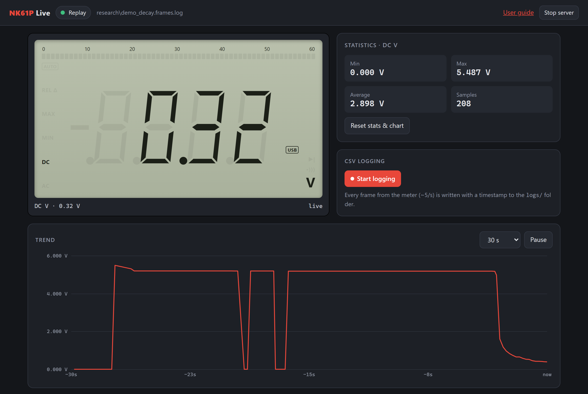
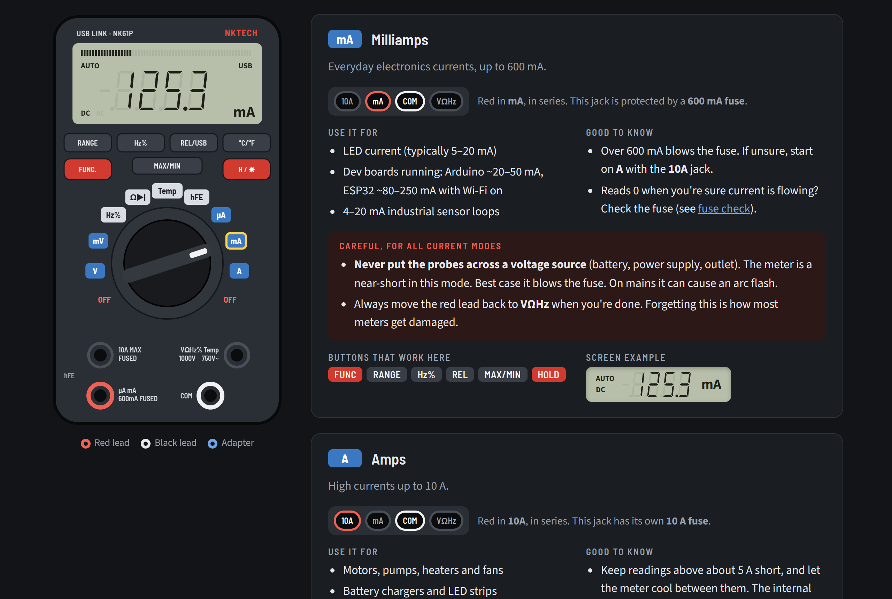

# NK61P Live

Live display, trend chart and CSV logger for the **NKTECH NK61P "USB Link"** multimeter, plus the first public
documentation of its USB data protocol.

The meter ships with a USB cable but no usable software. This reads it directly: plug it in, hold **REL/USB**,
and the dashboard mirrors the meter's screen in your browser while it logs every reading.



## What you get

- **Live display** drawn straight from the meter's own LCD segment data: digits, units, AUTO, REL, MAX/MIN, the 60-segment bar graph
- **Trend chart** (30 s to 1 h) with min / max / average
- **CSV logging**, about 5 readings per second, each timestamped
- **Every mode decoded**: DC/AC volts and mV, Hz and duty %, Ω, continuity, diode, capacitance, °C/°F, hFE, µA/mA/A
- **Illustrated user guide** for the meter: what each dial position is for, which jacks to use, and safety notes
- **Replay mode** to try it all without a meter, using real captures
- Auto-detects the meter, reconnects if it's unplugged, and needs only `pyserial`



## Quick start

```
git clone https://github.com/ccc6501/nk61p-live
cd nk61p-live
pip install -r requirements.txt
python nk61p.py
```

The dashboard opens at http://127.0.0.1:8061. Then:

1. Plug the meter into USB and turn it on.
2. **Hold REL/USB** until the **USB** icon shows on the meter's screen. Without it, the meter sends nothing.
3. Click **Start logging** when you want a CSV in `logs/`.

No meter? Watch a recorded sweep of every mode:

```
python nk61p.py --replay research/mode_sweep.frames.log
```

### Options

| Option | What it does |
|---|---|
| `--port COM8` | Use this port instead of auto-detecting (`/dev/ttyUSB0` on Linux) |
| `--log` | Start CSV logging right away |
| `--cli` | Print readings in the terminal, no web page |
| `--replay FILE` | Play back a capture instead of reading the meter |
| `--http-port 8061` / `--no-browser` | Web server settings |

### Platforms

- **Windows**: tested. The meter shows up as "USB-SERIAL CH340". Windows 10/11 usually installs the driver automatically; if not, install WCH's CH340 driver.
- **Linux**: should work; untested. The meter appears as `/dev/ttyUSB*`. You may need to add yourself to the `dialout` group.
- **macOS**: should work; untested. Recent macOS includes a CH340 driver. Older versions need WCH's driver.

### Windows desktop shortcut

```
powershell -ExecutionPolicy Bypass -File tools\install_shortcut.ps1
```

This creates **NK61P Live** on your desktop. It runs in the background with no console window and opens the dashboard.
Double-clicking it again just reopens the dashboard. Use **Stop server** in the dashboard header to quit.

## CSV format

`timestamp, elapsed_s, display, value, base_value, prefix, unit, mode, flags, bar, raw`

`display` is exactly what the meter shows. `base_value` is converted to the base unit, so 47.95 kΩ is stored as 47950.
`raw` is the frame in hex, so nothing is lost if you want to re-decode later.

## The protocol

The meter contains a CH340 USB-serial chip (USB ID `1A86:7523`). It runs at 2400 baud 8N1 with DTR high.
About 5 times a second it sends a 22-byte frame that is a copy of its LCD:

| Byte | Meaning |
|---|---|
| 0–1 | `aa 55` sync |
| 2–5 | `52 24 01 10` constant |
| 6–9 | Digits, 7-segment, byte 9 = leftmost. a=01 b=02 c=04 d=08 f=10 g=20 e=40. Bit 80 = decimal point to the **left** of the digit |
| 10 | 01 diode · 02 AC · 04 DC · 08 minus · 20 bar graph shown · 40 continuity |
| 11–17, 18 low nibble | 60-segment bar graph |
| 18 high nibble | 20 AUTO · 80 REL |
| 19 | 01 USB · 02 MAX · 08 MIN · 04 (lit with MAX+MIN) · 20 % · 40 hFE |
| 20 | 01 °C · 02 °F · 40 F (farads) · 80 n |
| 21 | 01 µ · 02 m · 04 A · 08 V · 10 M · 20 k · 40 Ω · 80 Hz |

Example: `aa 55 52 24 01 10 3d 3f 86 3d 24 ff ff ff ff ff ff 03 20 01 00 08` is **5.195 V DC, AUTO**, with 50 bar segments lit.

Every bit was confirmed by stepping through all dial positions and buttons and comparing against photos of the LCD.
The capture is in `research/mode_sweep.frames.log`. Not seen in the stream: HOLD and low battery. The first frame
after turning the dial is a blank `0000` while the meter switches.

The decoder is one file with no dependencies, [`nk61p_protocol.py`](nk61p_protocol.py), if you want to use it in your own code:

```python
from nk61p_protocol import FrameSplitter, decode

splitter = FrameSplitter()
for frame in splitter.feed(serial_bytes):
    r = decode(frame)
    print(r.display, r.prefix + r.unit, r.mode, r.value)
```

## Other meters

Cheap meters are often the same hardware under different names. If yours sends `aa 55` frames at 2400 baud, it may
already work. If it decodes but shows bits under **Protocol debug** on the dashboard, please open an issue with:

- a CSV log (`--log`) taken while you step through the modes
- a photo of the screen in each mode

That's how this meter's protocol was worked out.

## Tests

```
python -m unittest test_protocol
```

All test frames are real captures from an NK61P.

## Project layout

| Path | What it is |
|---|---|
| `nk61p.py` | Serial reader, CSV logger and local web server |
| `nk61p_protocol.py` | Frame decoder |
| `dashboard.html` | The live dashboard |
| `guide.html` | The illustrated user guide (served at `/guide`) |
| `research/` | Captures and the scripts used to decode them |
| `tools/` | Windows shortcut installer, icon and screenshot scripts |

## Disclaimer

Not affiliated with or endorsed by NKTECH. The user guide's safety notes don't replace the meter's own manual. When they disagree, follow the manual.

## License

MIT. See [LICENSE](LICENSE).
